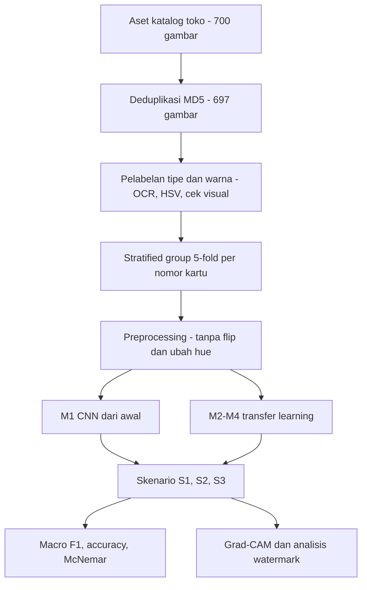

# PROPOSAL PENELITIAN

## Klasifikasi Tipe dan Warna Kartu *Digimon Card Game* Menggunakan *Convolutional Neural Network*

| | |
|---|---|
| **Mata Kuliah** | Riset Informatika |
| **Tahap** | Ujian Tengah Semester (UTS) |
| **Nama / NPM** | Muhammad Abdul Aziz / 23081010229 |
| **Waktu** | Oktober 2026 |

---

## Abstrak

Kartu *Digimon Card Game* memiliki dua atribut utama yang menentukan cara kartu dipilah, yaitu tipe (Digimon, Tamer, Option, Digi-Egg) dan warna (merah, biru, kuning, hijau, hitam, ungu, putih). Di toko *trading card game* (TCG), pemilahan berdasarkan kedua atribut ini masih dilakukan secara manual. Penelitian klasifikasi kartu TCG yang ada berfokus pada *Magic: The Gathering*, *Yu-Gi-Oh!*, dan *Pokémon*, dan belum menguji ketahanan model terhadap kartu *parallel*, yaitu kartu bernomor sama dengan ilustrasi berbeda. Penelitian ini mengusulkan klasifikasi tipe dan warna kartu *Digimon Card Game* dari gambar menggunakan *Convolutional Neural Network* (CNN). Dataset terdiri dari 697 gambar unik dari 503 kartu pada lima set, termasuk 194 gambar kartu *parallel*, dengan label warna mengikuti warna pojok kiri untuk kartu dua warna. Penelitian membandingkan CNN yang dilatih dari awal dengan tiga model *transfer learning* (MobileNetV2, ResNet-50, EfficientNet-B0) yang memprediksi tipe dan warna sekaligus. Evaluasi memakai *stratified group 5-fold cross-validation* per nomor kartu untuk mencegah kebocoran data, skenario ketahanan terhadap kartu *parallel* dan set baru, *macro F1-score*, *accuracy*, uji McNemar, serta analisis Grad-CAM.

**Kata kunci:** klasifikasi citra, *convolutional neural network*, *transfer learning*, *trading card game*, Digimon, Grad-CAM.

## Abstract

*Digimon Card Game* cards have two main attributes that determine how they are sorted: card type (Digimon, Tamer, Option, Digi-Egg) and color (red, blue, yellow, green, black, purple, white). In trading card game (TCG) stores, sorting by these attributes is still done manually. Existing research on TCG card classification focuses on *Magic: The Gathering*, *Yu-Gi-Oh!*, and *Pokémon*, and has not tested model robustness against parallel cards, which share a card number but carry a different illustration. This study proposes classifying the type and color of *Digimon Card Game* cards from images using convolutional neural networks (CNN). The dataset consists of 697 unique images of 503 cards from five sets, including 194 parallel-card images, with the color label of two-color cards taken from the left corner. The study compares a CNN trained from scratch with three transfer-learning models (MobileNetV2, ResNet-50, EfficientNet-B0) that predict type and color jointly. Evaluation uses stratified group 5-fold cross-validation by card number to prevent data leakage, robustness scenarios for parallel cards and unseen sets, macro F1-score, accuracy, McNemar's test, and Grad-CAM analysis.

**Keywords:** image classification, convolutional neural network, transfer learning, trading card game, Digimon, Grad-CAM.

---

# BAB I — PENDAHULUAN

## 1.1 Latar Belakang

*Digimon Card Game* adalah *trading card game* (TCG) terbitan Bandai, dengan set baru yang dirilis secara berkala. Setiap kartu memiliki **tipe**, yang menentukan fungsinya dalam permainan, dan **warna**, yang menentukan dek yang dapat memakainya. Kedua atribut ini juga menjadi dasar pengelompokan kartu di toko TCG, misalnya saat memilah stok atau menyusun katalog. Berdasarkan pengalaman penulis bekerja di toko TCG, pemilahan kartu masih dilakukan secara manual, sehingga lambat dan rawan salah pada volume besar.

*Convolutional Neural Network* (CNN) telah menjadi pendekatan standar klasifikasi citra [11], dan *transfer learning* dari bobot ImageNet [12] memungkinkan CNN bekerja baik pada dataset kecil karena fitur visual lapisan awal dapat dipindahkan antar-tugas [13]. Di Indonesia, penerapan *transfer learning* untuk klasifikasi citra cukup banyak, misalnya pada buah [9], makanan tradisional [8], daun herbal dan warna kulit [7], serta tokoh wayang [10]. Namun, hasil antar-arsitektur pada studi-studi tersebut sangat bergantung domain: selisih ResNet50 dan MobileNetV2 hanya sekitar 1 poin pada satu domain tetapi 21 poin pada domain lain [7], dan perbandingan EfficientNetV2 dan MobileNetV2 menghasilkan 31% berbanding 99% [8]. Hal ini menunjukkan perlunya protokol evaluasi yang hati-hati dan uji signifikansi.

Pada domain kartu permainan, Zilio dkk. menunjukkan bahwa CNN dapat memprediksi warna dan tipe kartu *Magic: The Gathering* [1]. Penelitian lain berfokus pada identifikasi atau deteksi kartu *Yu-Gi-Oh!* [2], [3], *Pokémon* [4], kartu remi [5], dan kartu Tarok [6]. Dari tinjauan yang dilakukan, belum ditemukan penelitian klasifikasi kartu *Digimon Card Game*, dan belum ada yang menguji ketahanan model terhadap **kartu *parallel***, yaitu kartu bernomor sama dengan ilustrasi berbeda. Pada data toko, gambar juga memuat watermark dan tulisan "SAMPLE" yang dapat menjadi jalan pintas bagi model.

Sekilas, tipe dan warna tampak mudah dikenali karena tercetak pada desain kartu. Namun, ada beberapa hal yang membuatnya layak diteliti: (1) model harus mengenali atribut dari desain kartu, bukan menghafal ilustrasi; (2) kartu dua warna membutuhkan aturan label, dan penelitian ini memakai warna pojok kiri sehingga augmentasi *horizontal flip* tidak boleh dipakai; (3) kelas sangat tidak seimbang, dengan 73,6% kartu bertipe Digimon dan hanya 5,2% berwarna putih [19]; dan (4) kartu reguler dan *parallel* yang sangat mirip dapat menyebabkan kebocoran data bila dibagi secara acak [18].

Berdasarkan celah tersebut, penelitian ini membandingkan CNN yang dilatih dari awal dengan tiga model *transfer learning*, yaitu MobileNetV2 [15], ResNet-50 [14], dan EfficientNet-B0 [16], untuk mengklasifikasikan tipe dan warna kartu *Digimon Card Game* sekaligus. Evaluasi memakai pembagian data per nomor kartu, skenario ketahanan terhadap kartu *parallel* dan set baru, uji McNemar [20], [21], dan analisis Grad-CAM [17].

## 1.2 Rumusan Masalah

1. Bagaimana performa CNN dalam mengklasifikasikan tipe dan warna kartu *Digimon Card Game* dari gambar kartu?
2. Apakah model *transfer learning* (MobileNetV2, ResNet-50, EfficientNet-B0) lebih unggul daripada CNN yang dilatih dari awal, dan apakah perbedaannya signifikan secara statistik?
3. Seberapa tahan model terhadap ilustrasi *parallel* dan terhadap set kartu yang tidak ada di data latih?
4. Bagian kartu mana yang menjadi dasar keputusan model (berdasarkan Grad-CAM), dan apakah watermark memengaruhinya?

## 1.3 Tujuan Penelitian

1. Membangun model CNN untuk mengklasifikasikan tipe dan warna kartu *Digimon Card Game*.
2. Membandingkan CNN dari awal dengan tiga model *transfer learning* secara adil (data, pembagian, dan prosedur pelatihan identik) disertai uji signifikansi.
3. Mengukur ketahanan model pada kartu *parallel* dan pada set kartu baru.
4. Menganalisis area perhatian model dengan Grad-CAM, termasuk pengaruh watermark.

## 1.4 Hipotesis

| No | H₀ (nol) | H₁ (alternatif) |
|---|---|---|
| 1 | *Macro F1* model *transfer learning* tidak berbeda dari CNN dari awal | Model *transfer learning* memiliki *macro F1* lebih tinggi |
| 2 | Tidak ada perbedaan performa antar-arsitektur *transfer learning* | Salah satu arsitektur lebih unggul |
| 3 | Performa pada kartu *parallel* (S2) sama dengan skenario utama (S1) | Performa pada kartu *parallel* lebih rendah |
| 4 | Performa pada gambar dengan overlay "SAMPLE" sama dengan tanpa overlay | Performa berbeda |

Hipotesis 1 dan 2 diuji dengan uji McNemar pada prediksi gabungan seluruh *fold*. Hipotesis 3 dan 4 diuji dengan selisih *macro F1* beserta interval kepercayaan 95% (*bootstrap*). Hipotesis 4 bersifat eksploratif karena overlay hanya ada di dua set. Hasil yang menolak maupun yang gagal menolak H₀ sama-sama dilaporkan sebagai temuan.

## 1.5 Batasan Masalah

1. Objek: kartu *Digimon Card Game* versi bahasa Jepang dari set BT01, BT21, BT22, BT23, dan EX08, termasuk beberapa kartu *reprint* dan promo di dalamnya (697 gambar unik, 503 kartu).
2. Tipe kartu: 4 kelas (Digimon, Tamer, Option, Digi-Egg). Warna kartu: 7 kelas (merah, biru, kuning, hijau, hitam, ungu, putih). Untuk kartu dua warna, label warna diambil dari bagian kiri bar nama kartu.
3. Input berupa gambar katalog satu kartu per gambar. Foto kamera dan deteksi banyak kartu sekaligus berada di luar cakupan.
4. Identifikasi berbasis visual; teks efek kartu tidak dibaca (tanpa OCR pada tahap klasifikasi).
5. Model: CNN dari awal, MobileNetV2, ResNet-50, dan EfficientNet-B0.
6. Kondisi fisik, keaslian, dan harga kartu tidak dinilai.

## 1.6 Manfaat Penelitian

- **Akademik:** mengisi celah literatur klasifikasi kartu TCG, khususnya *Digimon Card Game*, dengan evaluasi terkontrol atas pengaruh ilustrasi *parallel*, watermark, dan pembagian data yang bebas kebocoran.
- **Praktis:** komponen awal sistem pemilahan kartu otomatis untuk toko TCG.
- **Sumber daya:** dataset berlabel tipe dan warna beserta skrip dan *pipeline* yang dapat direproduksi.

## 1.7 Sistematika Penulisan

Proposal ini disusun dalam tiga bab. **Bab I Pendahuluan** memuat latar belakang, rumusan masalah, tujuan, hipotesis, batasan masalah, manfaat, dan sistematika penulisan. **Bab II Tinjauan Pustaka** memuat landasan teori tentang *trading card game*, CNN, *transfer learning*, data tidak seimbang, kebocoran data, Grad-CAM, dan penelitian terdahulu. **Bab III Metodologi Penelitian** memuat desain penelitian, dataset, pelabelan, *preprocessing*, pembagian data, model, skenario pengujian, evaluasi, hasil pilot, alat, jadwal, serta risiko dan mitigasinya. Bab IV Hasil dan Pembahasan serta Bab V Penutup akan disusun setelah eksperimen selesai.

---

# BAB II — TINJAUAN PUSTAKA (RINGKAS)

## 2.1 *Trading Card Game* dan *Digimon Card Game*

*Digimon Card Game* memiliki empat tipe kartu: **Digimon** (kartu monster dengan nilai DP dan level), **Tamer** (kartu karakter manusia), **Option** (kartu efek), dan **Digi-Egg** (kartu telur, tertulis DIGITAMA). Setiap kartu memiliki satu atau dua warna yang ditampilkan pada bingkai dan bar nama kartu. Selain versi reguler, banyak kartu dicetak dalam versi *parallel* dengan ilustrasi, bingkai, atau efek foil berbeda, tetapi tipe dan warnanya tetap sama.

## 2.2 *Convolutional Neural Network*

CNN mengenali pola citra melalui lapisan konvolusi bertingkat: lapisan awal menangkap tepi dan warna, sedangkan lapisan lebih dalam menangkap pola yang lebih kompleks [11]. Untuk tugas dengan dua keluaran, satu *backbone* CNN dapat dipasangi dua *output head* (tipe dan warna) dengan *loss* gabungan.

## 2.3 *Transfer Learning* dan Arsitektur yang Dibandingkan

*Transfer learning* memakai bobot yang sudah dilatih pada ImageNet [12], sekitar 1,2 juta citra dalam 1.000 kelas, lalu menyesuaikannya ke tugas baru. Fitur lapisan awal terbukti bersifat umum dan dapat dipindahkan [13]. Arsitektur yang dibandingkan:

| Arsitektur | Ciri utama | Rujukan |
|---|---|---|
| ResNet-50 | Koneksi residual yang memungkinkan jaringan sangat dalam | [14] |
| MobileNetV2 | *Inverted residual* dan *depthwise separable convolution*; ringan untuk perangkat terbatas | [15] |
| EfficientNet-B0 | Penskalaan seimbang lebar, kedalaman, dan resolusi | [16] |

## 2.4 Data Tidak Seimbang dan Kebocoran Data

Pada data tidak seimbang, *accuracy* dapat tinggi meskipun kelas kecil selalu salah, sehingga dibutuhkan metrik per kelas seperti *macro F1* dan teknik seperti pembobotan kelas [19]. Kebocoran data terjadi ketika informasi dari data uji ikut masuk ke data latih, dan merupakan penyebab umum hasil penelitian ML yang terlalu optimistis [18]. Pada dataset ini, kebocoran dapat terjadi jika gambar reguler dan *parallel* dari nomor kartu yang sama terpisah ke data latih dan data uji.

## 2.5 Grad-CAM

*Gradient-weighted Class Activation Mapping* (Grad-CAM) menghasilkan peta panas area citra yang paling memengaruhi keputusan kelas tertentu, berdasarkan gradien pada lapisan konvolusi terakhir [17]. Grad-CAM dipakai untuk memeriksa apakah model melihat bar nama dan tata letak kartu, bukan ilustrasi atau watermark.

## 2.6 Penelitian Terdahulu

Ringkasan dan peta celah penelitian terdapat pada dokumen **`03-Research-Gap/Research_Gap.md`**.

---

# BAB III — METODOLOGI PENELITIAN

## 3.1 Desain Penelitian

Penelitian eksperimental kuantitatif dengan rancangan 4 model × 3 skenario pengujian, masing-masing 5 putaran (60 pelatihan), ditambah analisis Grad-CAM.

## 3.2 Dataset

| Atribut | Nilai |
|---|---|
| Objek | Kartu *Digimon Card Game* versi bahasa Jepang |
| Sumber | Aset katalog toko Happy Hobbies, dipakai atas izin untuk keperluan akademik [26] |
| Set | BT01, BT21, BT22, BT23, EX08 |
| Jumlah | 700 file, 697 gambar unik, 503 kartu unik |
| Varian | 503 gambar reguler, 194 gambar *parallel* |
| Label | Tipe (4 kelas), warna (7 kelas) |
| Lokasi | `02-Dataset/dataset_metadata.csv` (metadata dan label), 25 gambar sampel di `02-Dataset/sampel/` |

Detail pembuatan, statistik, pemeriksaan kualitas, dan keterbatasan data ada di `02-Dataset/README.md`.

## 3.3 Pelabelan

| Label | Aturan | Cara |
|---|---|---|
| Tipe | Tulisan di bagian atas kartu: DIGIMON, TAMER, OPTION, DIGITAMA (dilabeli Digi-Egg) | OCR Tesseract, lalu pemeriksaan visual |
| Warna | Warna bagian kiri bar nama kartu; untuk kartu dua warna, warna pojok kiri | Histogram *hue* (HSV), lalu pemeriksaan visual |

Label diberikan per nomor kartu; gambar *parallel* mewarisi label kartu reguler-nya. Label akan diverifikasi ulang sebelum eksperimen utama, dan jumlah koreksinya dilaporkan.

## 3.4 *Preprocessing* dan Augmentasi

| Tahap | Rincian |
|---|---|
| Latar transparan | Sudut kartu yang transparan ditempel pada latar putih |
| Penyeragaman ukuran | Gambar dijadikan persegi dengan *padding* putih, lalu diubah ke 224×224 piksel |
| Normalisasi | *Mean* dan simpangan baku ImageNet |
| Augmentasi yang dipakai | Rotasi ±10°, pergeseran ±3%, skala 0,95–1,05, kecerahan dan kontras ±20%, *Gaussian blur* (p = 0,2) |
| Augmentasi yang **tidak** dipakai | *Horizontal flip* (memindahkan warna kiri ke kanan) dan perubahan *saturation*/*hue* (mengubah warna, padahal warna adalah label) |

## 3.5 Pembagian Data

Pembagian memakai *stratified group 5-fold cross-validation*: grup = nomor kartu, stratifikasi = gabungan tipe dan warna. Semua gambar dari nomor kartu yang sama selalu berada di *fold* yang sama sehingga tidak terjadi kebocoran antar-varian [18].

| Fold | Kartu | Gambar | Parallel |
|---|---:|---:|---:|
| 0 | 100 | 140 | 40 |
| 1 | 100 | 140 | 40 |
| 2 | 101 | 139 | 38 |
| 3 | 101 | 139 | 38 |
| 4 | 101 | 139 | 38 |

Dari data latih setiap *fold*, 15% kartu disisihkan sebagai data validasi untuk *early stopping*.

## 3.6 Model dan *Hyperparameter*

Setiap model memakai satu *backbone* dengan dua *output head*: tipe (4 kelas) dan warna (7 kelas). *Loss* = *cross-entropy* tipe + *cross-entropy* warna, keduanya dengan bobot kelas.

| Model | Konfigurasi awal | Pelatihan |
|---|---|---|
| **M1 CNN dari awal** | 4 blok konvolusi (32–64–128–256 filter, BatchNorm, ReLU, MaxPool), *global average pooling*, *dropout* 0,3 | Satu tahap, AdamW lr 1e-3, maksimal 60 *epoch*, *early stopping* sabar 10 |
| **M2 MobileNetV2** | Bobot ImageNet, *head dropout* 0,3 | Tahap 1: *backbone* dibekukan, lr 1e-3, 10 *epoch*; tahap 2: *fine-tuning* penuh, lr 1e-4, maksimal 30 *epoch*, sabar 5 |
| **M3 ResNet-50** | Sama dengan M2 | Sama dengan M2 |
| **M4 EfficientNet-B0** | Sama dengan M2 | Sama dengan M2 |

Optimizer AdamW [22] dengan *weight decay* 1e-4, *batch* 32. *Early stopping* memakai rata-rata *macro F1* tipe dan warna pada data validasi. Semua putaran memakai *seed* 42.

## 3.7 Skenario Pengujian

| Skenario | Data latih | Data uji | Putaran |
|---|---|---|---:|
| **S1 — Utama** | Semua gambar di 4 *fold* | Semua gambar di *fold* sisanya | 5 |
| **S2 — Ilustrasi *parallel*** | Hanya gambar reguler di 4 *fold* | Hanya gambar *parallel* di *fold* sisanya | 5 |
| **S3 — Set baru** | Semua gambar dari 4 set | Semua gambar dari 1 set sisanya (*leave-one-set-out*) | 5 |
| **Analisis** | — | Grad-CAM; gambar dengan vs tanpa overlay "SAMPLE" | — |

## 3.8 Evaluasi

Metrik (*macro F1*, *accuracy*, *balanced accuracy*, *precision*/*recall* per kelas, *confusion matrix*, *exact match*), uji McNemar [20], [21], analisis ketahanan, dan Grad-CAM dijelaskan lengkap pada **`05-Evaluation-Metric/Rencana_Evaluation_Metric.md`**.

## 3.9 Hasil Pilot (Uji Kelayakan Pipeline)

M1 (CNN dari awal) pada skenario S1 *fold* 0: 474 gambar latih, 83 gambar validasi, 140 gambar uji. Pelatihan berjalan 25 *epoch* (bobot terbaik di *epoch* 17) di CPU 2 inti tanpa GPU, total 18,6 menit. Konfigurasi sama dengan rencana, kecuali batas *epoch* diturunkan dari 60 menjadi 30 (sabar 8) karena keterbatasan waktu CPU. Model *transfer learning* (M2–M4) belum dijalankan karena bobot *pretrained* belum dapat diunduh di lingkungan penyusun; ketiganya dijalankan di Google Colab pada tahap berikutnya.

| Metrik (*fold* 0) | M1 CNN dari awal | *Baseline* kelas terbanyak |
|---|---:|---:|
| *Macro F1* tipe | 0,666 | 0,210 |
| *Macro F1* warna | 0,712 | 0,048 |
| *Accuracy* tipe / warna | 0,764 / 0,743 | 0,721 / 0,200 |
| *Exact match* | 0,529 | — |

Hasil ini menunjukkan bahwa (1) *pipeline* berjalan tanpa kebocoran data, dan (2) bahkan CNN sederhana tanpa *pretrained* sudah jauh di atas *baseline*, sehingga perbandingan dengan model *transfer learning* menjadi bermakna. Kesalahan terbanyak pada pilot adalah warna ungu yang ditebak hitam (10 dari 17) dan kartu Digimon yang ditebak Digi-Egg (13 dari 101). Detail ada di dokumen evaluasi.

## 3.10 Alat dan Lingkungan

Python 3, PyTorch [23], `timm` [24], scikit-learn [25], statsmodels, pandas, OpenCV/Pillow, `pytorch-grad-cam`; pelatihan utama di Google Colab (GPU T4); Git/GitHub untuk dokumentasi. Seluruh kode ada di `06-Kode/`.

## 3.11 Jadwal Penelitian (Usulan)

| Minggu | Kegiatan |
|---|---|
| 9 | Verifikasi label, finalisasi dataset dan pembagian data |
| 10 | Uji cepat *pipeline* di GPU; pelatihan M1 dan M2 pada skenario S1 |
| 11 | Pelatihan M3 dan M4; skenario S2 dan S3 |
| 12 | Evaluasi lengkap: metrik, uji McNemar, Grad-CAM, analisis watermark |
| 13 | **Presentasi 1:** latar belakang, celah riset, metodologi, hasil awal |
| 14 | **Presentasi 2:** hasil eksperimen utama |
| 15 | **Presentasi 3:** analisis ketahanan dan pembahasan |
| 16 | **Presentasi final** dan penyerahan draft paper |

*Sesuaikan dengan silabus mata kuliah.*

## 3.12 Risiko dan Mitigasi

| Risiko | Mitigasi |
|---|---|
| Akurasi sangat tinggi sehingga perbedaan antar-model tidak terlihat | Fokus analisis pada S2, S3, kelas sulit (putih, hitam, Digi-Egg), dan Grad-CAM; laporkan uji McNemar apa adanya |
| Kebocoran data antar-varian | Pembagian per nomor kartu; pemeriksaan otomatis tidak ada nomor kartu di dua sisi |
| Label salah | Verifikasi ulang manual; jumlah koreksi dilaporkan |
| Model belajar dari watermark | Grad-CAM; perbandingan set dengan dan tanpa overlay; akui keterbatasan karena overlay tercampur dengan set |
| Kelas sangat kecil (putih 26 kartu, Digi-Egg 31 kartu) | Bobot kelas, *macro F1*, stratifikasi gabungan tipe dan warna |
| Sesi Colab terputus | Hasil disimpan per putaran dan dapat dilanjutkan |
| Izin dan hak cipta data | Dipakai atas izin toko; hanya 25 sampel dipublikasikan; repositori dihapus setelah penilaian |

---

# DAFTAR PUSTAKA

[1] F. Zilio, M. Prates, and L. Lamb, "Neural networks models for analyzing Magic: The Gathering cards," *arXiv preprint* arXiv:1810.03744, 2018.

[2] Nyckel, "Yugioh card category — pretrained classifier." [Online]. Available: https://edge.nyckel.com/pretrained-classifiers/yugioh-card-category/ (accessed Oct. 2026).

[3] A. Rosebrock, "An interview with Anthony Lowhur — Recognizing 10,000 Yugioh cards with computer vision and deep learning," *PyImageSearch*, Mar. 3, 2021. [Online]. Available: https://pyimagesearch.com/2021/03/03/an-interview-with-anthony-lowhur-recognizing-10000-yugioh-cards-with-computer-vision-and-deep-learning/

[4] E. Pua, "Real-time Pokémon card detection from tournament footage," Stanford CS231n course project report, 2024. [Online]. Available: https://cs231n.stanford.edu/2024/papers/real-time-pokemon-card-detection-from-tournament-footage.pdf

[5] P. Wzorek and T. Kryjak, "Training dataset generation for bridge game registration," *arXiv preprint* arXiv:2109.11861, 2021.

[6] M. Čampelj, "Sistem za razpoznavo igralnih kart na osnovi globokega učenja [Deep learning-based playing card recognition system]," Diplomsko delo, Fakulteta za strojništvo, Univerza v Ljubljani, Ljubljana, 2022.

[7] H. Herlawati, A. A. Hendharsetiawan, W. Priatna, A. P. Dzulqiyana, and R. A. Rahmadanti, "Komparasi kinerja ResNet50 dan MobileNetV2 pada klasifikasi citra multi-domain," *J. Komtika (Komputasi dan Informatika)*, vol. 10, no. 1, pp. 46–61, 2026, doi: 10.31603/komtika.v10.i1.16926.

[8] A. Rayhan, R. Hidayat, and R. Afyenni, "Perbandingan akurasi EfficientNetV2 dan MobileNetV2 pada klasifikasi makanan tradisional Indonesia," *J. Cerita*, vol. 10, no. 2, pp. 124–127, 2024, doi: 10.33050/cerita.v10i2.3326.

[9] A. C. Hartono and A. R. Muslikh, "Penerapan transfer learning MobileNetV2 pada klasifikasi citra jenis buah-buahan," *J. Inf. Syst. Appl. Dev. (JISAD)*, vol. 3, no. 2, pp. 103–111, 2025, doi: 10.26905/jisad.v3i2.16187.

[10] W. Supriyanti and D. A. Anggoro, "Classification of Pandavas figure in shadow puppet images using convolutional neural networks," *Khazanah Informatika*, vol. 7, no. 1, 2021, doi: 10.23917/khif.v7i1.12484.

[11] Y. LeCun, Y. Bengio, and G. Hinton, "Deep learning," *Nature*, vol. 521, no. 7553, pp. 436–444, 2015, doi: 10.1038/nature14539.

[12] J. Deng, W. Dong, R. Socher, L.-J. Li, K. Li, and L. Fei-Fei, "ImageNet: A large-scale hierarchical image database," in *Proc. IEEE Conf. Comput. Vis. Pattern Recognit. (CVPR)*, 2009, pp. 248–255, doi: 10.1109/CVPR.2009.5206848.

[13] J. Yosinski, J. Clune, Y. Bengio, and H. Lipson, "How transferable are features in deep neural networks?" in *Adv. Neural Inf. Process. Syst. (NeurIPS)*, vol. 27, 2014, pp. 3320–3328.

[14] K. He, X. Zhang, S. Ren, and J. Sun, "Deep residual learning for image recognition," in *Proc. IEEE Conf. Comput. Vis. Pattern Recognit. (CVPR)*, 2016, pp. 770–778, doi: 10.1109/CVPR.2016.90.

[15] M. Sandler, A. Howard, M. Zhu, A. Zhmoginov, and L.-C. Chen, "MobileNetV2: Inverted residuals and linear bottlenecks," in *Proc. IEEE/CVF Conf. Comput. Vis. Pattern Recognit. (CVPR)*, 2018, pp. 4510–4520, doi: 10.1109/CVPR.2018.00474.

[16] M. Tan and Q. V. Le, "EfficientNet: Rethinking model scaling for convolutional neural networks," in *Proc. 36th Int. Conf. Mach. Learn. (ICML)*, PMLR vol. 97, 2019, pp. 6105–6114.

[17] R. R. Selvaraju, M. Cogswell, A. Das, R. Vedantam, D. Parikh, and D. Batra, "Grad-CAM: Visual explanations from deep networks via gradient-based localization," in *Proc. IEEE Int. Conf. Comput. Vis. (ICCV)*, 2017, pp. 618–626, doi: 10.1109/ICCV.2017.74.

[18] S. Kapoor and A. Narayanan, "Leakage and the reproducibility crisis in machine-learning-based science," *Patterns*, vol. 4, no. 9, p. 100804, 2023, doi: 10.1016/j.patter.2023.100804.

[19] H. He and E. A. Garcia, "Learning from imbalanced data," *IEEE Trans. Knowl. Data Eng.*, vol. 21, no. 9, pp. 1263–1284, 2009, doi: 10.1109/TKDE.2008.239.

[20] Q. McNemar, "Note on the sampling error of the difference between correlated proportions or percentages," *Psychometrika*, vol. 12, no. 2, pp. 153–157, 1947, doi: 10.1007/BF02295996.

[21] T. G. Dietterich, "Approximate statistical tests for comparing supervised classification learning algorithms," *Neural Comput.*, vol. 10, no. 7, pp. 1895–1923, 1998, doi: 10.1162/089976698300017197.

[22] I. Loshchilov and F. Hutter, "Decoupled weight decay regularization," in *Proc. Int. Conf. Learn. Represent. (ICLR)*, 2019.

[23] A. Paszke *et al.*, "PyTorch: An imperative style, high-performance deep learning library," in *Adv. Neural Inf. Process. Syst. (NeurIPS)*, vol. 32, 2019, pp. 8024–8035.

[24] R. Wightman, "PyTorch image models," GitHub repository, 2019, doi: 10.5281/zenodo.4414861.

[25] F. Pedregosa *et al.*, "Scikit-learn: Machine learning in Python," *J. Mach. Learn. Res.*, vol. 12, pp. 2825–2830, 2011.

[26] Happy Hobbies, "Aset katalog gambar kartu Digimon Card Game (BT01, BT21, BT22, BT23, EX08)," koleksi internal toko, tidak dipublikasikan; digunakan atas izin untuk keperluan akademik, 2025.
