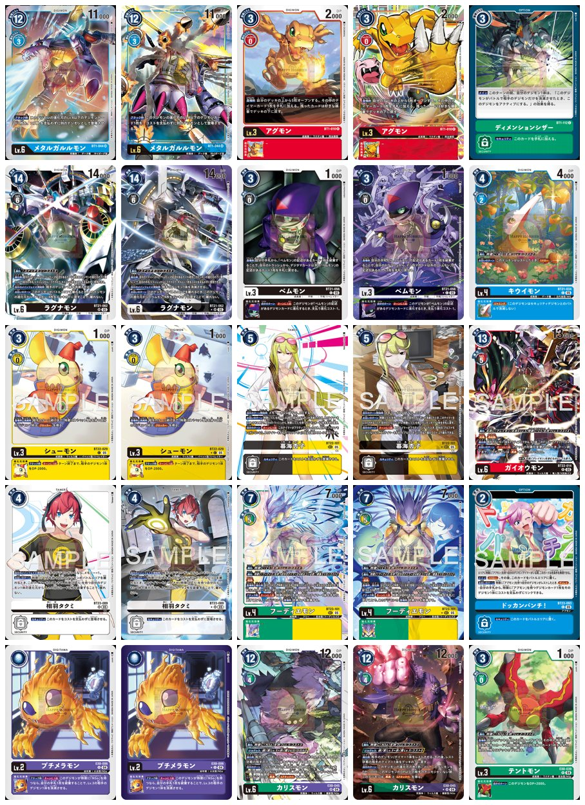
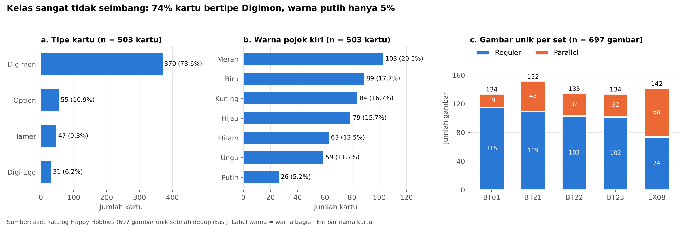

# DATASET RENCANA RISET KECIL — KARTU DIGIMON CARD GAME

## 1. Ringkasan

| Atribut | Keterangan |
|---|---|
| Nama dataset | Gambar Kartu *Digimon Card Game* Berlabel Tipe dan Warna |
| Objek | Kartu *Digimon Card Game* versi bahasa Jepang |
| Cakupan set | BT01, BT21, BT22, BT23, EX08 (termasuk beberapa kartu *reprint* dan promo di dalamnya) |
| Jumlah file | 700 gambar PNG |
| Jumlah gambar unik | 697 (3 duplikat persis dikeluarkan) |
| Jumlah kartu unik | 503 nomor kartu |
| Varian | 503 gambar reguler, 194 gambar *parallel* (dari 164 kartu) |
| Label | Tipe kartu (4 kelas) dan warna kartu (7 kelas, warna pojok kiri) |
| Format | PNG RGBA, 430×600 piksel (sebagian besar BT21: 869×1213 piksel) |
| Sumber | Aset katalog toko Happy Hobbies, dipakai atas izin untuk keperluan akademik [26] |
| Isi repositori | 25 gambar sampel, metadata 700 file, label 503 kartu, skrip pembangun metadata |



*Gambar 1. Pratinjau 25 sampel. Setiap baris adalah satu set (BT01, BT21, BT22, BT23, EX08). Pada setiap baris, kartu 1–2 dan 3–4 adalah pasangan versi reguler dan parallel dari nomor kartu yang sama.*

## 2. Skema Data (Data Dictionary)

Berkas utama: `dataset_metadata.csv` (700 baris, satu baris per file gambar).

| Kolom | Tipe | Contoh | Keterangan |
|---|---|---|---|
| `image_id` | teks | `BT01/BT1-089_P1.png` | Path relatif folder/nama file |
| `folder_set` | teks | `BT01` | Folder set tempat gambar disimpan |
| `card_code` | teks | `BT1-089` | Nomor kartu; **kunci grup** saat membagi data |
| `card_set` | teks | `BT01` | Set asli kartu hasil normalisasi (`BT1` → `BT01`) |
| `card_no` | teks | `089` | Nomor urut kartu di dalam set |
| `variant` | kategori | `parallel_1` | `base`, `parallel_1`, `parallel_2`, `parallel_3` |
| `is_parallel` | 0/1 | `1` | 1 jika gambar adalah versi parallel |
| `is_reprint_or_promo` | 0/1 | `0` | 1 jika set asli kartu berbeda dengan folder |
| `duplicate_of` | teks | (kosong) | Terisi jika file merupakan duplikat persis dari file lain |
| `width`, `height` | bilangan bulat | `430`, `600` | Resolusi gambar (piksel) |
| `md5` | teks | `0fbbe303…` | Hash file untuk deduplikasi |
| `has_sample_overlay` | 0/1 | `1` | 1 jika gambar memuat tulisan "SAMPLE" |
| `card_type` | kategori | `Tamer` | **Label 1:** Digimon, Tamer, Option, Digi-Egg |
| `color` | kategori | `green` | **Label 2:** red, blue, yellow, green, black, purple, white |

Berkas pendukung:

| Berkas | Isi |
|---|---|
| `label_tipe_warna.csv` | Label per nomor kartu (503 baris): `card_code`, `folder_set`, `card_type`, `color`, `label_status` |
| `sampel_metadata.csv` | Metadata dan label 25 gambar sampel di folder `sampel/` |
| `build_metadata.py` | Skrip pembangun `dataset_metadata.csv` dari nama file dan penggabung label |
| `eda_dataset_digimon.png` | Grafik distribusi label dan komposisi set |

## 3. Proses Pembuatan

1. **Pengumpulan.** Gambar kartu dikumpulkan dari aset katalog toko Happy Hobbies, yang awalnya dibuat untuk listing marketplace. Gambar disimpan per folder set dengan pola nama `<SET>-<NO>.png` (reguler), `<SET>-<NO>_P<k>.png` (parallel ke-*k*), dan `P-<NO>.png` (promo).
2. **Parsing nama file.** `build_metadata.py` membaca nomor kartu, set, dan varian dari nama file dengan *regular expression*, lalu menormalkan kode set (`BT1` → `BT01`).
3. **Deduplikasi.** Setiap file di-*hash* dengan MD5. File dengan hash sama ditandai di kolom `duplicate_of`; file hasil unduh ganda (berakhiran `(1)`) diurutkan terakhir sehingga yang ditandai adalah salinannya.
4. **Pelabelan tipe.** Tulisan tipe di bagian atas kartu (DIGIMON, TAMER, OPTION, DIGITAMA) dibaca dengan OCR Tesseract. Kartu yang gagal terbaca dilabeli melalui pemeriksaan visual.
5. **Pelabelan warna.** Warna dominan bagian kiri bar nama kartu diperkirakan dari histogram *hue* (ruang warna HSV). Bar yang hampir tidak berwarna dilabeli putih atau hitam berdasarkan kecerahannya.
6. **Pemeriksaan visual.** Seluruh 503 kartu ditampilkan dalam lembar kontak beserta label prediksinya, lalu dikoreksi secara manual. Contoh koreksi: kartu *full art* yang bar namanya tertutup ilustrasi.
7. **Pewarisan label.** Label diberikan per nomor kartu, dan gambar parallel mewarisi label kartu reguler-nya.

## 4. Statistik Deskriptif



*Gambar 2. Distribusi tipe dan warna (per kartu) serta komposisi reguler dan parallel per set (per gambar).*

**Per set (gambar unik):**

| Set | Gambar unik | Kartu unik | Reguler | Parallel | % parallel | Reprint/promo | Overlay "SAMPLE" | Resolusi |
|---|---:|---:|---:|---:|---:|---:|---|---|
| BT01 | 134 | 115 | 115 | 19 | 14,2% | 0 | Tidak | 430×600 |
| BT21 | 152 | 109 | 109 | 43 | 28,3% | 21 | Tidak | 134 gambar 869×1213; 18 gambar 430×600/601 |
| BT22 | 135 | 103 | 103 | 32 | 23,7% | 2 | Ya | 430×600 |
| BT23 | 134 | 102 | 102 | 32 | 23,9% | 0 | Ya | 430×600 |
| EX08 | 142 | 74 | 74 | 68 | 47,9% | 0 | Tidak | 430×600 |
| **Total** | **697** | **503** | **503** | **194** | **27,8%** | **23** | 269 gambar | |

**Distribusi label per kartu unik (n = 503):**

| Warna \ Tipe | Digimon | Option | Tamer | Digi-Egg | Total |
|---|---:|---:|---:|---:|---:|
| Merah (red) | 77 | 11 | 10 | 5 | 103 |
| Biru (blue) | 64 | 12 | 7 | 6 | 89 |
| Kuning (yellow) | 61 | 10 | 7 | 6 | 84 |
| Hijau (green) | 60 | 9 | 4 | 6 | 79 |
| Hitam (black) | 47 | 5 | 7 | 4 | 63 |
| Ungu (purple) | 44 | 6 | 6 | 3 | 59 |
| Putih (white) | 17 | 2 | 6 | 1 | 26 |
| **Total** | **370** | **55** | **47** | **31** | **503** |

**Distribusi label per gambar unik (n = 697, termasuk parallel):** Digimon 495, Tamer 101, Option 63, Digi-Egg 38; merah 146, biru 115, hijau 115, kuning 105, hitam 95, ungu 80, putih 41.

**Jumlah varian per kartu:** 339 kartu hanya punya versi reguler, 136 kartu punya 1 parallel, 26 kartu punya 2 parallel, dan 2 kartu punya 3 parallel.

## 5. Pemeriksaan Kualitas Data

| Pemeriksaan | Hasil |
|---|---|
| File sesuai pola nama | 700 dari 700 (1 file berakhiran `(1)` tetap terbaca) |
| Duplikat persis (MD5) | 3 file: `BT1-029_P1(1).png`, serta `P-201.png` dan `P-201_P1.png` yang muncul di BT22 dan BT23 |
| Satu gambar reguler per kartu | Terpenuhi untuk 503 dari 503 kartu |
| Parallel tanpa kartu reguler | 0 |
| Nomor kartu muncul di lebih dari satu folder | 0 (setelah deduplikasi) |
| Label kosong | 0 |
| Konsistensi label reguler–parallel | Terjamin, karena label diwariskan per nomor kartu |
| Kebocoran antar-*fold* (uji pembagian data) | 0 nomor kartu muncul di dua sisi pada 15 putaran S1–S3 |

## 6. Keterbatasan yang Perlu Diketahui

1. **Watermark.** Semua gambar memuat watermark toko, dan semua gambar BT22 dan BT23 juga memuat tulisan besar "SAMPLE". Karena overlay hanya ada di dua set itu, pengaruh watermark **tercampur** dengan pengaruh set.
2. **Gambar katalog, bukan foto kamera.** Hasil penelitian belum tentu berlaku untuk foto kartu fisik dengan pencahayaan dan sudut berbeda.
3. **Kelas tidak seimbang.** Digimon 73,6% kartu; putih hanya 5,2% (26 kartu) dan Digi-Egg putih hanya 1 kartu.
4. **Label masih draft.** Label dibuat semi-otomatis dan diperiksa visual satu kali. Label akan diverifikasi ulang sebelum eksperimen, terutama kelas putih dan kartu *full art*/*ACE*.
5. **Aturan warna pojok kiri** adalah keputusan peneliti untuk kartu dua warna, bukan atribut resmi tunggal dari penerbit.
6. **Cakupan lima set.** Distribusi warna dan tipe pada set lain dapat berbeda.

## 7. Pembagian Data (Rencana)

Pembagian memakai *stratified group 5-fold cross-validation*: grup = `card_code`, stratifikasi = gabungan tipe dan warna, `random_state = 42`. Semua gambar dari nomor kartu yang sama selalu berada di *fold* yang sama, sehingga tidak terjadi kebocoran data antar-varian [18].

| Fold | Kartu | Gambar | Parallel |
|---|---:|---:|---:|
| 0 | 100 | 140 | 40 |
| 1 | 100 | 140 | 40 |
| 2 | 101 | 139 | 38 |
| 3 | 101 | 139 | 38 |
| 4 | 101 | 139 | 38 |

Dari data latih setiap *fold*, 15% kartu disisihkan sebagai data validasi (stratifikasi warna). Skenario tambahan: S2 (latih reguler, uji parallel) dan S3 (*leave-one-set-out*), dijelaskan di proposal.

## 8. Rencana Perluasan

| Perluasan | Tujuan | Status |
|---|---|---|
| Verifikasi ulang label oleh peneliti | Kualitas label; jumlah koreksi dilaporkan | Direncanakan sebelum eksperimen |
| Foto kamera kartu fisik (±100–200 foto) | Menguji perbedaan domain katalog → kamera | Opsional, tahap lanjut |
| Set tambahan tanpa overlay "SAMPLE" | Memisahkan pengaruh watermark dari pengaruh set | Opsional |
| Kolom level, rarity, dan tipe tambahan | Tugas klasifikasi lanjutan | Di luar cakupan UTS |

## 9. Sitasi Sumber Data

Gambar kartu berasal dari aset katalog toko Happy Hobbies [26] dan dipakai atas izin untuk keperluan akademik non-komersial. Ilustrasi kartu adalah hak cipta Bandai. Watermark tidak dihapus atau dimodifikasi. Repositori hanya memuat 25 gambar sampel, dan dataset lengkap disimpan secara privat. Repositori akan dihapus setelah penilaian selesai.

Membuat ulang metadata:

```bash
python build_metadata.py <folder_dataset> dataset_metadata.csv label_tipe_warna.csv
```

## Daftar Pustaka

[18] S. Kapoor and A. Narayanan, "Leakage and the reproducibility crisis in machine-learning-based science," *Patterns*, vol. 4, no. 9, p. 100804, 2023, doi: 10.1016/j.patter.2023.100804.

[26] Happy Hobbies, "Aset katalog gambar kartu Digimon Card Game (BT01, BT21, BT22, BT23, EX08)," koleksi internal toko, tidak dipublikasikan; digunakan atas izin untuk keperluan akademik, 2025.
