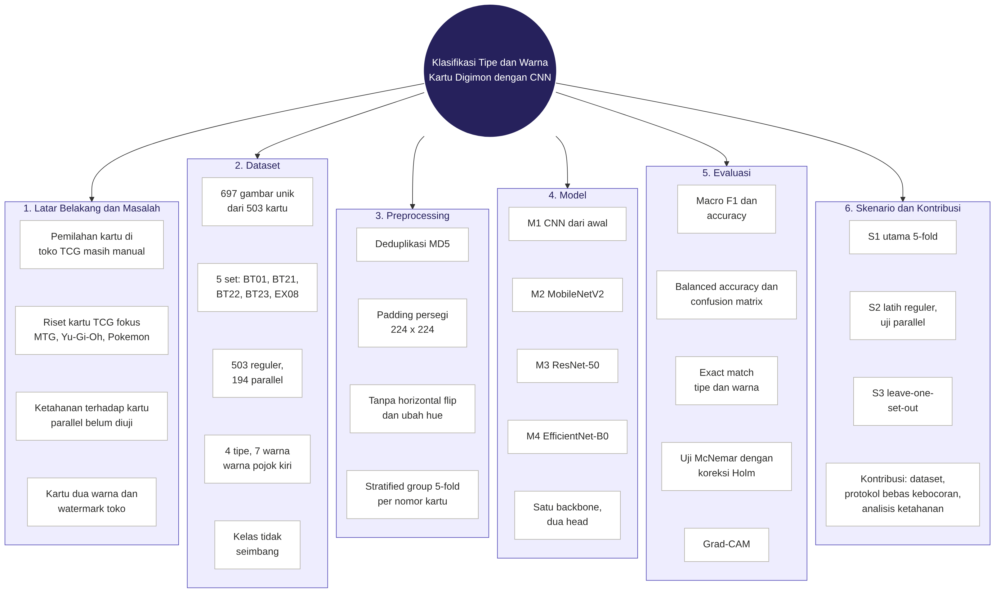
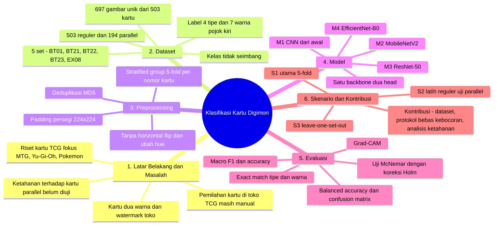
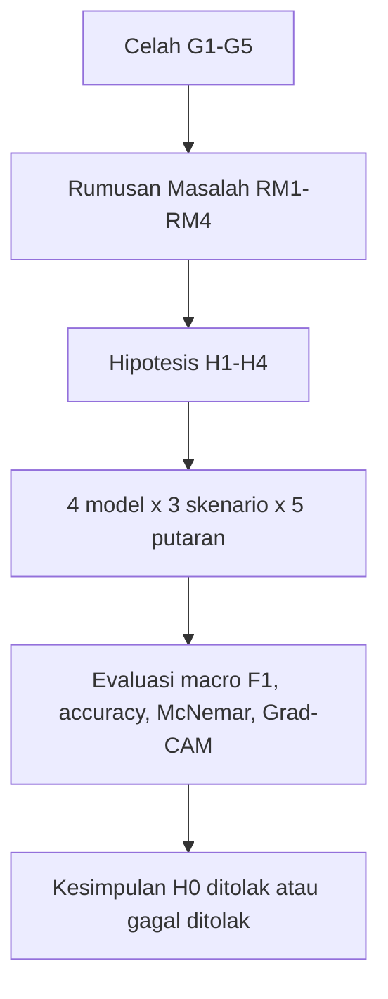

# RESEARCH MIND MAP

**Topik:** Klasifikasi Tipe dan Warna Kartu *Digimon Card Game* — CNN dari awal vs *Transfer Learning*

## Versi gambar

Versi pohon yang lebih rinci: [research_mind_map_detail.png](research_mind_map_detail.png).

## Versi teks (Mermaid, tampil otomatis di GitHub)

## Alur logika penelitian

